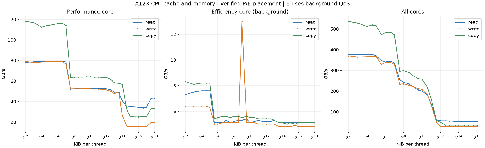
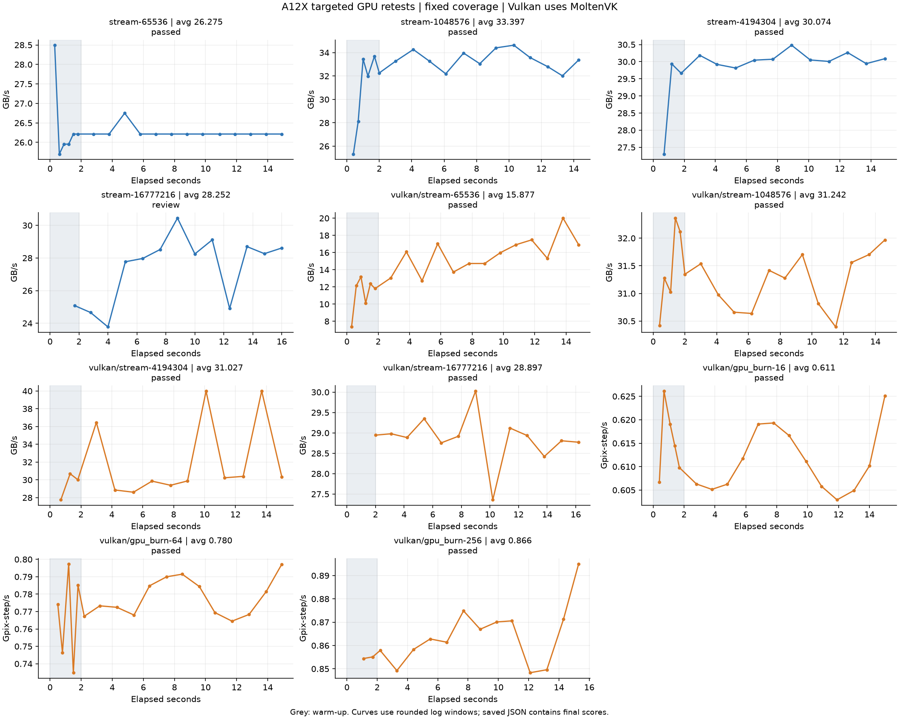

# A12X／iPad Pro 第三代补测（2026-10-14）

14 个定向项目已完成，选用 16 条新成绩：13 项通过，Metal 16M 绘制保留稳定性提示。原来的 4 个异常项目都已完成复测，并在本轮检测到稳定窗口；GPU 缓存独立 L2／L3／SLC 归属按用户决定不纳入验收。

手机历史共 72 条，原 43 条逐项核对未改动。本轮新增 29 条，其中 13 条属于其他真实尝试／调度条件，全部保留，没有按最高分挑选。当前全套精选 31 项／33 条已通过生产模型匹配核对；本轮实际跑的是 14 项补测及必要复核，没有重新点击执行整套 31 项按钮。

## CPU 和内存

| 测量 | 成绩 | 条件 |
| --- | ---: | --- |
| 大核算力 | 111.527 MWork/s | 大核驻留 ≥99.999%，约 2.484 GHz |
| 小核算力 | 60.013 MWork/s | Utility，无辅助线程；小核驻留 ≥99.998%，约 1.572 GHz |
| 全核算力 | 656.340 MWork/s | 4 大核＋4 小核工作线程，3 轮共 24 个线程样本全部通过驻留／占用检查 |
| CPU 全核内存读取 | 53.737 GB/s | 267 个缓存／内存曲线点，大小核单线程分别验证；页面首次访问和文件存储已测 |
| Vulkan GPU 内存读取 | 57.903 GB/s | MoltenVK，整轮同步墙钟；77 个曲线点，34 次写入／复制检查通过 |

全核采用共同实际时间分母，各工作线程贡献相加等于保存总分。24 个线程样本中最低类型驻留 99.7637%，最低执行占用 96.6134%；这是核心类型验证，不是指定编号核心的绑定。旧全核请求 8 个线程时，部分轮次没有让小核充分参与，不能把线程数当作已经跑满的证据。新 `apple_pe_qos_workers_v1` 记录实际调度与验证结果，与旧继承优先级的记录区分。

小核正常算力两轮为 60.100／60.013 MWork/s，相差约 0.15%。A15 的原有前台＋大核辅助负载策略保持不变。A12X 使用 Utility 无辅助线程策略；后台算力 20.419 MWork/s、约 0.54 GHz 另存，不混作正常频率成绩。

**CPU 缓存／内存的小核曲线仍采用明确标记的后台策略**：L1／L2／内存读取约 7.5／5.2／5.1 GB/s，不能当成正常频率小核的峰值。Utility 的短时内存写入未达到占用要求，失败尝试没有保存成绩；App 默认沿用已经验证的后台内存测法。算力与内存各自自动选用可验证的策略，没有新增界面选项。

## GPU 定向结果

粒子 GB/s 是既定的 40 B／粒子吞吐指数，不等于直接测得的缓存或显存总线速度。固定画面覆盖，1280×720，15 秒包含 2 秒预热；Vulkan 使用 MoltenVK。

| 项目 | 本轮选用均值 | 单位 | 已检测稳定段 | 状态 |
| --- | ---: | --- | ---: | --- |
| stream-65536 | 26.275 | GB/s | 26.209 | passed |
| stream-1048576 | 33.397 | GB/s | 33.930 | passed |
| stream-4194304 | 30.074 | GB/s | 30.072 | passed |
| stream-16777216 | 28.252 | GB/s | — | review |
| vulkan/stream-65536 | 15.877 | GB/s | — | passed |
| vulkan/stream-1048576 | 31.242 | GB/s | 31.285 | passed |
| vulkan/stream-4194304 | 31.027 | GB/s | 29.321 | passed |
| vulkan/stream-16777216 | 28.897 | GB/s | 28.811 | passed |
| vulkan/gpu_burn-16 | 0.611 | Gpix-step/s | 0.610 | passed |
| vulkan/gpu_burn-64 | 0.780 | Gpix-step/s | 0.776 | passed |
| vulkan/gpu_burn-256 | 0.866 | Gpix-step/s | 0.867 | passed |
| vulkan/memory_sweep | 57.903 | GB/s | — | passed |

Metal 16M 两轮均值 27.399／28.252 GB/s，变化约 3.11%；早晚下降分别 1.54%／−0.80%，热状态均 0→0，计时区间核对通过。每帧绘制约 1.2 秒，15 秒测试仅约 12 帧，两轮都没有找到连续 5 个窗口 CV<2% 的稳定段，因此保留 review，不擅自标成稳定，也没有继续重复测量挑分。

Vulkan 4M 的最新均值 31.027、已检测稳定段 29.321 GB/s，整轮早晚变化为升高 11.61%；存在稳定窗口不意味着整轮每秒都不变。Vulkan 16M 最新 28.897、稳定段 28.811 GB/s，下降 1.29%。所有选用项目热状态均 0→0；未采集独立 GPU 频率，不把波动直接判成温控降频。

## 修复及验证范围

- MoltenVK 内存扫描开始前选择整轮同步计时，使用较长 dispatch 减少提交／唤醒开销；原时间戳异常尝试被拒绝，没有混合计时保存。安卓／鸿蒙原生 Vulkan 选择路径保持不变。
- A12X 短内存窗口的进程／线程统计存在约 5 ms 差异，改用线程分层统计，并保留 CPU 时钟守恒与 99% 类型归属要求。
- A12X 算力采用 Utility 小核和明确请求的 4P＋4E 全核工作线程；实际驻留、执行占用逐轮记录。原编号核心绑定限制仍存在。
- iOS 真机 Release 编译、签名、安装通过；CPU 归属／取消和 Vulkan 保存合同检查通过；共享 MoltenVK 同步计时实际运行 29 点通过。生产模型对选用 14 项／16 条及全套 31 项／33 条匹配通过。
- 本轮没有复测 A15、Mac、安卓或鸿蒙。A15 原 128 条档案哈希保持不变。

设备 App 已停止（PID 2544），完整 Documents 已归档，正常锁屏行为恢复，可以拔线。

## 文件

- [完整 72 条历史](phone-final/results/results.json)
- [全套精选 33 条](curated-suite-results.json)
- [本轮选用 16 条](selected-results.json)
- [核对记录](verification.json)／[实际生产模型匹配](production-contract-audit.json)／[全核 24 个线程样本](all-worker-rounds.json)
- [GPU 曲线 PNG](gpu-curves.png)／[PDF](gpu-curves.pdf)／[CSV](gpu-curves.csv)
- [CPU 内存曲线 PNG](cpu-memory-curves.png)／[PDF](cpu-memory-curves.pdf)／[CSV](cpu-memory-curves.csv)

