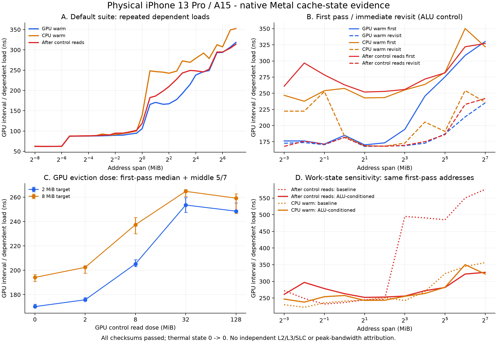

# A15 手机缓存对照补测（2026-10-14）

本轮真机测量已结束，Mangekyo 测试进程已停止。只测试 iPhone 13 Pro／A15，未继续模拟器、Mac、A12X 或其他平台的工作。GPU L2／L3／SoC-SLC 的独立峰值速度仍没有可靠归属证据；本轮补出了第一次访问、再次访问、驱逐量和工作状态的真实对照，并将硬件计数样本与实际 GPU 工作关联。

## 本轮执行与保存

| 真机测试 | 保存编号 | 结果 |
| --- | --- | --- |
| 首次访问／再次访问，GPU／CPU 预热和驱逐量对照 | `20261014-185659-720-metal-cache-controls` | 11 个工作集 × 11 个条件 × 7 次；847 组对照，242 点；55.2 秒，XCTest 通过 |
| 相同对照，增加 GPU ALU 运算预处理 | `20261014-190255-965-metal-cache-controls` | 847 组对照，242 点；61.2 秒，XCTest 通过 |
| 日常完整 Metal 缓存测试 | `20261014-190645-149-metal-cache` | 124 点；37.2 秒，真机流程 passed |

三轮开始／结束的系统热状态均为 0→0。共新增 608 个曲线点，两轮对照共 1,694 组首次／再次访问配对，所有负载的索引与累加校验均通过。热状态正常不能证明固定频率。

手机历史从 125 条增加到 128 条，原 125 个成绩对象逐项比较未改变。原始最终数据：[results.json](phone-final/results/results.json)。实验单独保存为 `gpu_cache_controls`，没有替换常规 `gpu_cache` 合同。当前全套精选仍为 31 个已测项目／33 条成绩：[精选成绩](curated-current-a15-results.json)，只更新其中日常 GPU 缓存记录。

生产 Swift 合同与曲线解析核对通过：[验证输出](production-parser-verification.txt)。CPU 曲线 267 点（其中 P/E 186 点）、Metal 内存 52 点、Vulkan 内存 77 点、GPU 缓存状态 124 点；此前 CPU 算力、内存、页面首次访问、文件存储成绩保留。实际 OS 换页／压缩吞吐没有被这些项目测量。本轮没有重新点击手机整套一键按钮。

## 方法与关键数据

每次使用相同种子生成的随机完整地址环，节点间距 128 字节。工作集为 128 KiB 到 128 MiB 的 11 个倍增点。第一次定时访问 `min(节点数, 8192)` 个节点，不绕环；随后从相同起点立即再读同一段。每对读之前重做控制：128 MiB CPU 读、256 MiB GPU 读，再按条件 GPU 完整遍历或 CPU 读取目标，并额外读取 2／8／32／128 MiB 的 GPU 或 CPU 控制缓冲。条件顺序轮转，取 7 次中位数。

第二轮在目标准备后加入不读取目标的 ALU 运算，4096 个线程各执行 131072 次整数递推，写回结果并核对两个端点。GPU 区间中位数 6.40637 ms。零目标读取的定时控制中位数 0.0025417 ms。两者是工作状态／计时开销的对照，既不是缓存刷新指令，也没有锁住 GPU／内存频率。

以下为第二轮 GPU 预热条件的原始 GPU 区间除以依赖读取次数，单位 ns／次；包括循环、校验累加和提交区间开销，不是纯粹单条硬件 load 的延迟。

| 工作集 | 首次访问 | 立即再次访问 |
| --- | ---: | ---: |
| 2 MiB | 170.20 | 167.74 |
| 4 MiB | 173.29 | 168.38 |
| 8 MiB | 194.16 | 168.84 |
| 16 MiB | 245.53 | 172.75 |
| 32 MiB | 275.45 | 187.18 |
| 128 MiB | 330.09 | 235.25 |

2 MiB 目标的额外 GPU 驱逐量从 0／2／8／32／128 MiB 增加时，首次访问中位数为 170.20／175.80／205.24／253.58／248.57 ns。它确认控制读量会改变目标访问表现，但不能把驱逐缓冲大小直接当作硬件缓存容量。

128 MiB 目标在基础控制读之后首次访问由未加 ALU 预处理的 576.26 ns，变为加预处理的 327.05 ns；8 MiB 目标由 494.89 变为 255.85 ns。目标地址序列与控制读方法相同，说明这种差异不能仅解释为某层缓存命中率。ALU 预处理也可能影响内存工作状态、时间间隔和缓存保持，不能据此宣布已消除所有频率因素。

原始逐次样本：[第一轮 CSV](raw-controls.csv)、[ALU 对照 CSV](raw-controls-alu.csv)。保存曲线：[608 点 CSV](all-new-curves.csv)。

可导出：[PDF 曲线](cache-controls.pdf)。

## 硬件计数核对与归属限制

使用实际 A15 Performance Limiters 配置录制 30 秒、保留末端 2 秒窗口，得到 [原始 trace](cache-tail-counters.trace)。录制结束时正在进行 96 MiB 目标的读取，没有完成该轮常规成绩；该轮不计入上表的通过成绩，随后重新独立完成日常测试。末端窗口重定时间轴，实际保留约 1.134 秒，不能将窗口中的 0 秒误认成应用启动前。

本轮新增 Metal 对象标签及 GPU 执行区间导出，将 50,000 个硬件计数区间与 Mangekyo 实际活动区间求交。[核对摘要](active-counter-summary.json) 的约 75 ms 有界样本确实对应目标地址环访问，解决了上一阶段仅采到应用运行前背景活动的证据不足。该短窗口的 GPU LLC 指标约 0.0634%，GPU 外部读取约 0.1876 GB/s；它们是此单链低占用工作段的观察值，不是整轮均值或最大带宽。

公开 Metal 接口仍只提供 `timestamp/GPUTimestamp`。外部 Instruments 提供 GPU LLC、MMU、外部读写带宽等指标，未提供单独命名的 L2／L3／SLC 命中和分层流量。LLC 百分比不能换算出独立缓存峰值 GB/s；GPU 外部访问也不能保证来自 DRAM，可能经过共享缓存。CPU 预热后继续读取其他地址亦不是已验证的 CPU 私有缓存刷新。

因此本轮能确认缓存保持、重访收益、驱逐量影响和明显的工作状态敏感性。仍不能把这些数值可靠拆成 GPU L2、GPU L3 和 SoC/SLC 三项独立速度，保存的 `cacheAttribution=unverified` 保留。不能给未确认的层级填一个正式分数。

核查材料：[机器验证](verification.json)、两轮 [XCTest 结果](controls.xcresult)／[ALU 结果](controls-alu.xcresult)、[完整日常运行日志](final-native-cache.log)、[最终手机 Documents](phone-final)。最后的无效组合参数保护仅作静态库编译确认；不影响本轮已安装版本测过的有效路径。
