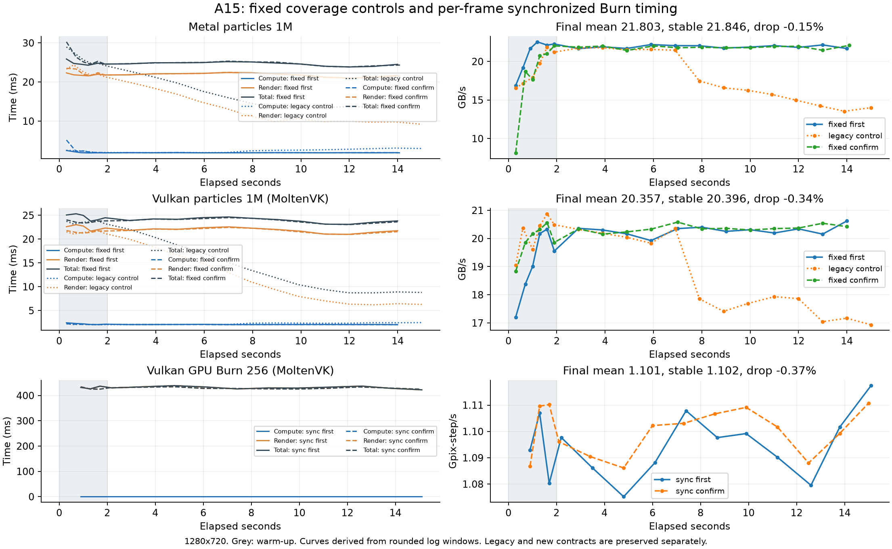

# A15 大小核与 3 项 GPU 问题修复验证（2026-10-14）

大小核分开测量成功，3 项 GPU 问题修正后均通过两轮验证。最终验证的 13 项全部通过；本轮手机历史从 78 增至 105 条，所有旧对象逐项相等。

## CPU 实测

| 测试 | 成绩 | 编号 |
| --- | ---: | --- |
| 大核单线程 | 146.994 MWork/s | `20261014-154547-670-cpu-single-performance` |
| 小核单线程（后台 QoS） | 26.740 MWork/s | `20261014-154547-697-cpu-single-efficiency` |
| 全核 6 线程 | 661.557 MWork/s | `20261014-154547-713-cpu-multi` |

系统报告 2 个大核、4 个小核；没有按编号绑核。使用 QoS 请求类型，再以公开 task_info 的大核 CPU 时间、进程总 CPU 时间与线程 CPU 时钟计算保守驻留下界，每轮必须达到 99%。小核进度暂存至测量结束后发送，未通过验证的观察不保存成正式小核成绩。后台小核成绩不代表最高频率上限；iOS 没有提供本方法所需的周期计数。

两轮成功与此前两轮拒绝的所有记录见 audit.json。CPU 缓存／内存扫描也验证了分核默认路径，保留大小核曲线和驻留下界。

## GPU 修正与对照

| 项目 | 首轮修正均值 | 最终均值 | 最终稳定段 | 最终下降 |
| --- | ---: | ---: | ---: | ---: |
| Metal particles 1M | 21.905 | 21.803 | 21.846 | -0.15% |
| Vulkan particles 1M (MoltenVK) | 20.298 | 20.357 | 20.396 | -0.34% |
| Vulkan GPU Burn 256 (MoltenVK) | 1.095 | 1.101 | 1.102 | -0.37% |

粒子单位为 GB/s，按计算阶段每粒子 40 B 推导；不是独立 DRAM 扫描带宽。Burn 单位为 Gpix-step/s。

旧绘制对照重新出现下降：Metal 1M 32.94%，Vulkan 1M 13.69%。恢复固定画面覆盖后稳定，支持动态绘制负载影响的判断。新版本只绕回顶点显示坐标，计算内核和粒子数量不变；版本标记为 fixed_coverage_v2，与旧绘制成绩分组保存。iOS 普通按钮与一键按钮默认使用新版，无新增选项。其他平台默认显示方式不变。

iOS MoltenVK Burn 始终以每帧提交／栅栏完成的实际耗时计分，完整运行都不依赖 GPU 查询。旧查询均值 1.367／1.623 继续保留为旧观察值；不能把新旧变化直接归因为硬件性能变化。Mac MoltenVK Burn 计时策略保留原方式。

同一路径的 65K／4M／16M 绘制档位在两种 API 上也完成新版验证。系统热状态及每个结果的计时条件见 audit.json。日志中的吞吐下降说明已改为计时／负载／调度复核，不再自动断言温控降频。

## 文件

- [完整手机 results.json](policy-final/results/results.json)
- [历史保留、驻留与计时核对](verification.json)
- [逐轮清单、结果及原生日志](audit.json)
- [全部 GPU 曲线 CSV](curves.csv)
- [GPU 曲线 PNG](gpu-fix-curves.png) / [PDF](gpu-fix-curves.pdf)
- [构建指纹](build-info.json)
- [当前选定全套 33 条成绩](curated-suite-results.json)

方法参考：[Apple QoS](https://developer.apple.com/library/archive/documentation/Performance/Conceptual/EnergyGuide-iOS/PrioritizeWorkWithQoS.html)、[公开 task_power_info_v2 结构](https://developer.apple.com/documentation/kernel/task_power_info_v2_data_t)、[XNU task CPU 时间实现](https://github.com/apple-oss-distributions/xnu/blob/main/osfmk/kern/task.c)。

