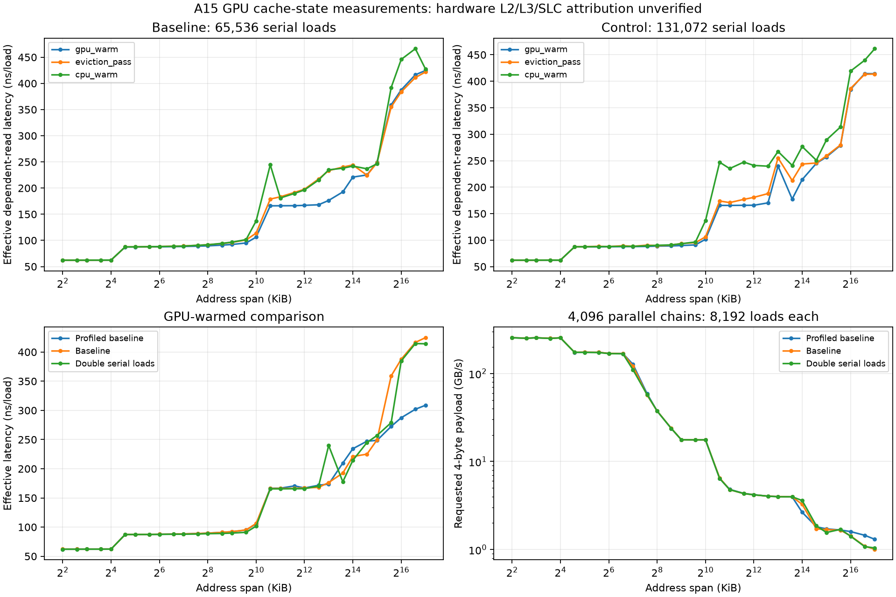

# A15 GPU 缓存补查（2026-10-14）

真机测量已经结束，手机可以拔线。完成的是缓存状态扫描和读取次数对照；**GPU L2／L3／SoC-SLC 独立归属仍未建立，不能标为完成，也没有生成这些硬件层级的独立分数。**

## 最终手机状态（18:35 AEDT 后完成存档）

本轮最终共 5 次完整缓存扫描、620 个校验通过的曲线点。最后两次专项成绩为
`20261014-182221-741-metal-cache`（Instruments 界面采集）和
`20261014-183550-918-metal-cache`（已保存的真实 Performance Limiters 配置采集），
均覆盖 4 KiB–128 MiB、四种条件，前后热状态 0→0。

已成功取得 **30 个硬件计数器定义及实际采样**，包括 GPU Last Level Cache
Limiter／Utilization、MMU 指标、GPU 外部读写带宽。正确的 A15 分析配置为
profile 3；从 Instruments 实际选择并保存配置后，再以 xctrace 记录成功。
原始跟踪 `a15-limiters-final.trace` 已保存（约 643 MiB），完整计数器定义见
[hardware-counter-inventory.json](hardware-counter-inventory.json)。
[counter-sample.json](counter-sample.json) 保存前 1,000 个实际区间，包含 30 个硬件指标
与 2 个工具派生指标；这段样本用于确认采集成功，位于基准启动前，不能当作测试带宽。

这些硬件指标仍没有分别命名 L2、L3、SLC 的独立命中／流量计数器。
GPU Last Level Cache 利用率也不是独立 GB/s 峰值，GPU 外部带宽可能经过 SLC，
不能称为纯 DRAM 或 SLC 带宽。因此新增的是可靠的硬件观测证据，独立层级速度
仍标为未归属。Apple 对 GPU LLC 的说明见
[GPU 计数器介绍](https://developer.apple.com/videos/play/wwdc2020/10603/)。

最终手机完整历史为 [phone-final/results/results.json](phone-final/results/results.json)，
120→125 条，原 120 条逐对象未改写。当前全套选择为
[curated-current-a15-results.json](curated-current-a15-results.json)，31 个已测项目／33 条成绩，
跨此前及本轮已完成的专项选择，不是新增一轮完整按钮运行。
生产 Swift 解析及合同核对通过：CPU 曲线 267 点（其中 186 个分核点）、Metal 52、
Vulkan 77、缓存状态 124；CPU 页映射和文件存储结果齐全。
核对见 [phone-final-verification.json](phone-final-verification.json) 和 `verify/output.txt`。

真机测试和采集均已停止。用户要求先收尾手机，不继续修改其他测试；Vulkan 保留
已验证项目及现有开关，缓存仍明确未归属。下文是前三轮补查的历史记录。

| 运行 | 条件 | 成绩编号 | 保存点数 |
| --- | --- | --- | ---: |
| 外部跟踪 | 65,536 次串行读取；Metal System Trace 同时记录 | `20261014-173652-182-metal-cache` | 124 |
| 新版证据保存 | 65,536 次串行读取 | `20261014-174431-970-metal-cache` | 124 |
| 次数对照 | 131,072 次串行读取；并行仍为 8,192 次／线程 | `20261014-174539-439-metal-cache` | 124 |

每轮都覆盖 4 KiB–128 MiB、31 个地址跨度，包含 GPU 预热、清扫后、CPU 预热、4,096 链并发读取。所有读取和清扫校验通过。后两轮专项 XCTest 通过，热状态均为 0→0；前一轮生产清单也通过。

小工作集 4 KiB GPU 预热延迟为 62.212／62.090 ns/读取，读取次数加倍后差异约 0.20%；2 MiB 为 166.197／165.530，差异约 0.40%。固定启动开销没有主导这些点。大工作集会受运行状态影响：128 MiB 三轮分别为 308.706／424.580／414.175 ns/读取，即使系统热状态正常也不应把其中一次称为硬件固定延迟或峰值。

## 独立归属为什么仍未完成

本轮在 A15 上枚举了公开 Metal 的完整计数器清单，只有 `timestamp/GPUTimestamp`。它不能直接提供各级缓存命中／未命中和 SLC 流量证据。现在原始日志及新成绩配置都保存 `counterInventory` 和 `attributionEvidence=timing_and_checksum_only`，保留 `cacheAttribution=unverified`。

最初记录了 65 秒 Metal System Trace。该默认模板实际记录 `Counter Set: (null)`、`counter-profile=0`，导出的计数器表为空。随后成功打开 Instruments，保存真正的 profile 3 配置并取得上方的硬件数据。profile 1 探针报告不支持，不能以它推断 A15 不支持硬件计数。界面新文档的保存曾不可用，临时副本仅有不完整的 RunIssues 数据，保存在 `incomplete-gui-trace-snapshot/`，不能当成有效跟踪；有效最终跟踪为 `a15-limiters-final.trace`。

时间曲线会同时受到数据缓存、地址翻译、并发和系统状态影响；CPU 预热也未隔离 CPU 私有缓存与 SLC。仅靠曲线转折不能可靠命名 L2、L3 或 SLC。Apple 官方流程要求先核对设备支持的计数器：[计数器能力检查](https://developer.apple.com/documentation/metal/confirming-which-counters-and-counter-sets-a-gpu-supports)、[Xcode GPU 分析](https://developer.apple.com/documentation/xcode/analyzing-apple-gpu-performance-using-counter-statistics)。

## 保存与历史

完整历史为 [results.json](final-documents/results/results.json)，120→123 条，原 120 条逐对象核对未改写。原始日志在 `attachments/` 和 `profiled-documents/suite-runs/`；外部跟踪为 `metal-system.trace`，导出表在本目录。

[核对 JSON](verification.json) · [曲线 CSV](curves.csv) · [可导出 PDF](cache-curves.pdf)

串行曲线单位是有效 ns/读取，包含读取循环与调度开销；并行曲线只计每次请求的 4 字节负载，不能与顺序 DRAM 带宽直接比较。加倍读取次数的记录使用独立 v3/8192 配置，未覆盖默认 v2 成绩。CPU 大小核 L1／L2 测试属于此前已完成的另一套测量。
