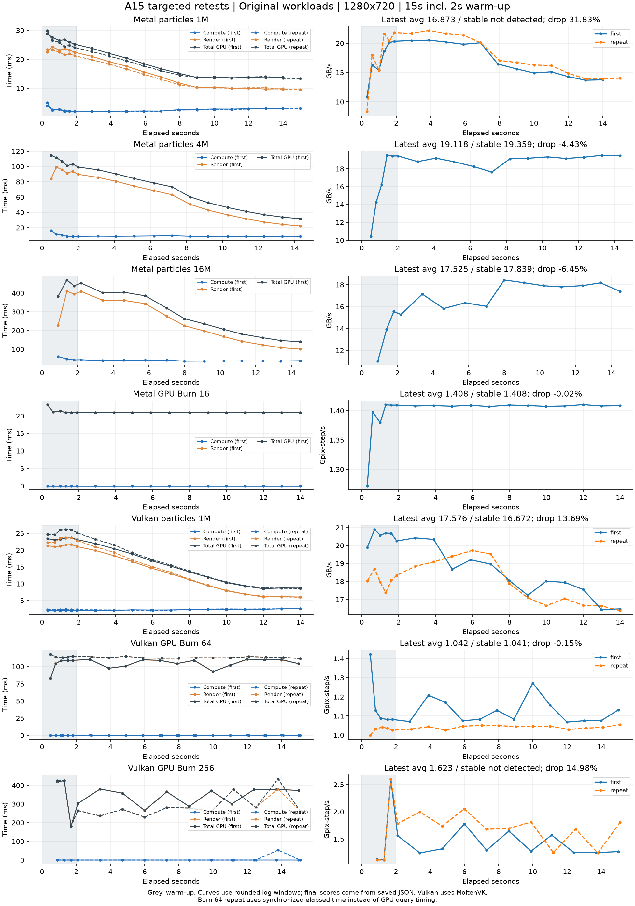

# A15／iPhone 13 Pro 定向复测（2026-10-14）

7 项均已完成，其中 4 项额外复核一次，共新增 11 条成绩。原有 67 条逐项校验未改动，手机历史现在共 78 条。保存字段中的平均计时区间核对通过；Vulkan Burn 256 仍保留逐帧计时诊断要求。

当前构建：Release、`5c4e7df`，iOS 27.0.1，1280×720，原始着色器，15 秒运行含 2 秒预热。每项独立启动，间隔 20 秒，并由应用在开始前检查系统热状态；若非正常则等待降温。

Vulkan 是 MoltenVK 转到 Metal。Metal 单帧序列化计时；Vulkan 粒子使用双帧，Burn 使用单帧并验证 GPU 时间戳。请求关闭垂直同步，但 iOS 的显示路径仍跟随屏幕同步，结果中的 `vsync=true` 反映平台行为。

| 项目 | 原均值 | 本轮均值 | 已检测稳定段 | 前后下降 | 热状态 | 判断 |
| --- | ---: | ---: | ---: | ---: | --- | --- |
| Metal 粒子 1M | 12.886 | 16.873 | 未检测到 | 31.83% | 0→0 | 保留复核 |
| Metal 粒子 4M | 16.318 | 19.118 | 19.359 | -4.43% | 0→0 | 通过 |
| Metal 粒子 16M | 15.884 | 17.525 | 17.839 | -6.45% | 0→0 | 通过 |
| Metal GPU Burn 16 | 1.203 | 1.408 | 1.408 | -0.02% | 0→0 | 通过 |
| Vulkan 粒子 1M | 19.614 | 17.576 | 16.672 | 13.69% | 0→0 | 保留复核 |
| Vulkan GPU Burn 64 | 1.074 | 1.042 | 1.041 | -0.15% | 0→0 | 通过（同步计时） |
| Vulkan GPU Burn 256 | 0.967 | 1.623 | 未检测到 | 14.98% | 0→0 | 保留复核 |

粒子单位为 GB/s（计算阶段按每粒子 40 B 推导，不能当作独立内存扫描带宽）；Burn 单位为 Gpix-step/s。旧计时／提交帧数与本轮不同的项目，变化幅度不能全归因于性能提升。

## 所有观察值

| 项目 / 轮次 | 成绩编号 | 均值 | 稳定段 | CV | 前后下降 | 热状态 |
| --- | --- | ---: | ---: | ---: | ---: | --- |
| Metal 粒子 1M / 首次 | `20261014-151024-717` | 16.102 | 20.225 | 1.26% | 29.02% | 0→0 |
| Metal 粒子 4M / 首次 | `20261014-151106-433` | 19.118 | 19.359 | 0.66% | -4.43% | 0→0 |
| Metal 粒子 16M / 首次 | `20261014-151148-681` | 17.525 | 17.839 | 1.42% | -6.45% | 0→0 |
| Metal GPU Burn 16 / 首次 | `20261014-151230-376` | 1.408 | 1.408 | 0.07% | -0.02% | 0→0 |
| Vulkan 粒子 1M / 首次 | `20261014-151312-744` | 17.935 | 17.759 | 1.81% | 11.47% | 0→0 |
| Vulkan GPU Burn 64 / 首次 | `20261014-151354-657` | 1.121 | 0.000 | -1.00% | 1.77% | 0→0 |
| Vulkan GPU Burn 256 / 首次 | `20261014-151438-374` | 1.367 | 0.000 | -1.00% | 9.10% | 0→0 |
| Metal 粒子 1M / 复核 | `20261014-151514-853` | 16.873 | 0.000 | -1.00% | 31.83% | 0→0 |
| Vulkan 粒子 1M / 复核 | `20261014-151558-315` | 17.576 | 16.672 | 1.29% | 13.69% | 0→0 |
| Vulkan GPU Burn 64 / 复核 | `20261014-151639-505` | 1.042 | 1.041 | 0.82% | -0.15% | 0→0 |
| Vulkan GPU Burn 256 / 复核 | `20261014-151723-794` | 1.623 | 0.000 | -1.00% | 14.98% | 0→0 |

下降比例来自最早与最后各 5 个计时窗口，不是硬件频率遥测；负数表示吞吐上升。`stableScore=0` 表示未检测到稳定段。检测到的稳定段可能在早期，不能在后期下降时当作最终持续成绩。系统热状态 0 是正常状态，不能据此断言 GPU 没有调频。

## 本轮判断

Metal 4M、16M、Burn 16 达到稳定段且没有大于 5% 的前后吞吐下降，原复测候选可以关闭。两种 API 的 1M 绘制下降都在第二轮重现，计时核对通过，但不能当作固定负载的稳定硬件峰值。

1M 曲线显示：绘制时间随运行缩短，FPS 接近 60 后计算时间增加。当前证据提示动态绘制负载和显示同步需要纳入解释；没有固定画面密度的 A15 独立对照，也没有硬件频率遥测，不能把原因写成已证实的温控降频。Mac 的隔离诊断不代替这台手机的验证。

Vulkan Burn 64 复核时，GPU 时间戳报告 0.216 ms，而同步提交／等待实际为 115.976 ms，已触发自动回退。回退后均值 1.042 Gpix-step/s、稳定段 1.041、CV 0.82%，通过；它按同步实际耗时计分，不能与第一轮 GPU 查询计时的 1.121 当作同一口径。

Vulkan Burn 256 两轮均无稳定段，均值 1.367／1.623 Gpix-step/s、前后下降 9.10%／14.98%。第二轮启动时校准为 425.549 ms GPU／426.142 ms 同步等待，随后各窗口仍有明显波动，平均 GPU 时间为 296.257 ms、帧间隔为 432.945 ms。初始校准和平均区间自洽不足以证明整轮查询都可靠；该项目还需要逐帧同步计时对照，当前均值只保留作观察值。

此次候选测试已经完成，不再重复标准 15 秒测试挑选更高分；后续如要解释剩余波动，应做独立计时／调度／负载对照。

## 原始证据

- [完整手机成绩](repeat-final/results/results.json)
- [本次核对与文件指纹](verification.json)
- [逐项计时、热状态、日志路径](audit.json)
- [当前 32 条全套选定成绩](curated-suite-results.json)
- [完整曲线 CSV](curves.csv)
- [曲线 PNG](a15-curves.png) / [PDF](a15-curves.pdf)

