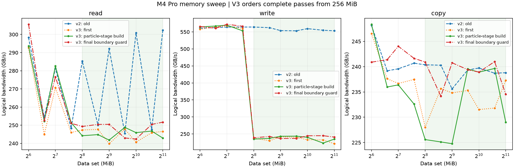
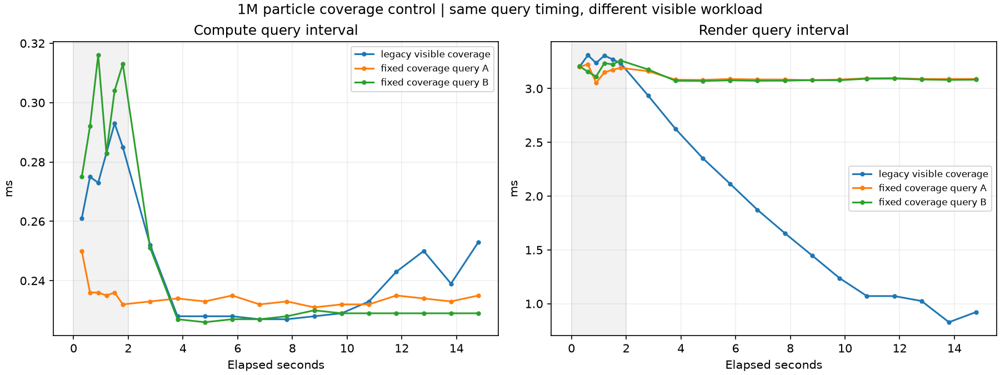
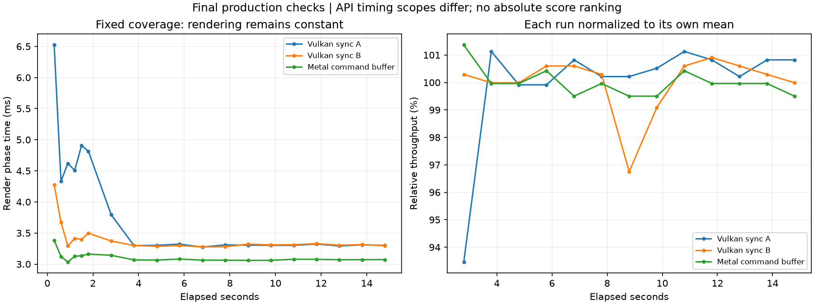

# M4 Pro 测法修复与最终复核（2026-10-16 开始，17 日完成）

本轮修复了 Mac 待办中的软件问题：Vulkan 内存的大数据集重复方式、粒子画面
负载随时间变化、以及不同粒子计时范围混用。用户明确要求“继续修复，直到完成”，
授权本轮必要实现调整；没有为了贴合某个分数降低阈值或修改历史成绩。

CPU、GPU Burn、流体和独立缓存归属没有追加测试或改变内核。
原 A15、两台 A12X、A16 的原始快照保持不变；本轮没有 iOS 真机测量。

## 已完成的软件修复

### Vulkan 内存：大数据集按完整缓冲区重复

V2 的 write/copy 由一个工作组拥有 512 KiB chunk，并在该工作组内反复访问。
即使申请了 2 GiB，总数据集大小也不能排除每个工作组重复命中缓存。
旧 read 把多轮访问展开为可并发工作组；大数据集还出现约 247/301 GB/s 的
交替。数据校验通过只证明内容正确，不证明访问都到达 DRAM。

V3 在 **256 MiB 及以上**每次 dispatch 完整遍历数据集一次，重复轮次间建立
compute 执行与内存依赖；write/copy 的重复次数为每次 dispatch 一遍，仍由
唯一工作组拥有 chunk。该 read 路径直接按 chunk 编号寻址，去除取模。
小数据集与 L1 探针保留缓存诊断方式，完整曲线仍保存，方法切换不是缓存容量。
所有字节数仍按实际逻辑 load/store 计算，copy 计入读和写，不作倍率修饰。

使用新身份 **`membw_v3_streaming`**，V1/V2 原记录保留；各平台的完成清单
只复用带新遍历标记及有效校验的新版本。没有平台的 V3 结果仍保存 preview 并
显示 review，不会因校验成功而冒充正式平台。

平台判断还要求尾部三个数据集都至少为 256 MiB，且带宽差仍满足原 20% 阈值。
256 MiB 上限的尾部为 128/192/256 MiB，混合了缓存重复与完整遍历，不能用它们
声明平台；正常扫描至少到 512 MiB 才有三个方法一致的尾点。默认上限仍为 2 GiB。

| 默认扫描 | 读取 GB/s | 写入 GB/s | 复制 GB/s | 校验/平台 |
| --- | ---: | ---: | ---: | --- |
| 第一轮 V3 | 245.897 | 232.499 | 231.819 | 46 次校验通过，读取平台达到 |
| 粒子复核阶段构建 V3 | 245.908 | 234.9 | 238.9 | 46 次校验通过，读取平台达到 |
| 最终边界保护构建 V3 | 250.419 | 244.7 | 238.9 | 46 次校验通过，读取平台达到 |

最终写入/复制数值为原始结果字符串中保存的一位小数；全部点的更高精度中位数在
原生日志和 CSV。三轮均为默认 1–2048 MiB、3 次预热、10 次测量，95 点，
全程统一同步墙钟，零时间戳异常。正式默认版本为 `membw_v3_streaming_moltenvk`。

最后一轮之后只做一次 `--membw-max-mib 256` 负向复核：77 点、34 次数据校验
通过，但 `memoryPlateauReached=0`，保存为 `membw_v3_streaming_preview_moltenvk`，
生产界面与 C++ 均提示 review。它的 249.937 GB/s 是最大几个数据集的诊断汇总，
写入 550.5 GB/s 也混入缓存重复；均不作为正式内存带宽。默认轮次的变动保留，
没有按最高分筛选。边界保护不涉及粒子或 Metal 实现，未因此重跑其稳定项目。

浅绿色区为 V3 完整缓冲区重复的区间。256 MiB 处写入曲线的方法变化不能解释为
某一硬件缓存容量；L1/L2/L3/SLC 独立归属仍未验证。这是有校验的内核访问平台，
不是硬件 DRAM 流量计数或绝对物理峰值。

### 粒子：保持可见负载，明确完成计时

Apple 桌面默认使用现有 wrapped-NDC 覆盖着色器，与 iOS 原有固定覆盖一致。
原位置更新、粒子数量和 40 B 计分常量不变；只把显示坐标回绕到视口，避免
粒子逐渐离开画面。新绘制记录有 `_fixed_coverage_v2`，抓帧文件也带独立覆盖标记。
Windows/Android/HarmonyOS 的粒子默认与内核未改。

同为查询计时的对照先确认覆盖修复效果，再切换最终完成计时，避免把两个改动
混在一起归因：旧渲染区间从约 3.2 ms 降至不足 1 ms；固定覆盖 A/B 两轮在
预热后约 3.1 ms 保持平稳，吞吐变化分别 0.14%/-0.91%。

Mac MoltenVK 粒子此前内部 compute 查询明显短于整个命令缓冲/帧完成区间，
不适合拿它直接除以 Metal 整个 compute 命令缓冲的时间来解释 GPU/API 优劣。
现在 Mac 与 iOS 的 MoltenVK 粒子统一使用逐帧提交/等待完成计时，带 `_sync_timing`；
Android/HarmonyOS 原生 Vulkan 的查询与验证路径保持不变。

Metal headless 的实现仍是 GPU 命令缓冲起止时间，原方法没有发现明显跨度错误；
本次把原来笼统的 `gpu_timestamp_query` 改为准确的 `command_buffer_gpu_time`，
新身份加 `_command_buffer_timing_v1`。没有为了提高 Metal 分数而换计算内核或字节数。

依据 [Apple 的 GPUStartTime 说明](https://developer.apple.com/documentation/metal/mtlcommandbuffer/gpustarttime)，
该差值是命令缓冲的 GPU 执行时长。Vulkan 同步墙钟还包含提交、等待和调度成本；
尤其小任务，不同时间范围不能直接作为纯 GPU 峰值比值。同步路径配置仍有两个
资源帧槽，但每帧都会等待完成，有效执行并发为一帧，不能把槽数理解成两帧并发。

### 成绩复用与回归保护

- Mac 一键补缺不再复用旧覆盖、旧 MoltenVK 查询粒子或旧 CPU 无分支记录。
- 各平台 Vulkan 内存复用需要 V3、完整遍历标记、成功数据校验和零查询异常。
- Apple、Android、HarmonyOS 的 V3 未达到平台时均显示 review。
- 旧数据继续可查，未自动改标签，也没有删除波动或对照记录。

## 最终构建的实测

| 项目 | 整轮均值 GB/s | 稳定段 GB/s | 前后下降 % | GPU总时间/帧间隔 ms |
| --- | ---: | ---: | ---: | ---: |
| Vulkan 固定覆盖 1M，A | 126.338 | 127.000 | -1.73 | 3.655 / 3.724 |
| Vulkan 纯计算 1M | 111.462 | 110.963 | 0.64 | 0.376 / 0.377 |
| Vulkan 纯计算 16M | 146.072 | 146.859 | -0.80 | 4.594 / 4.595 |
| Metal 固定覆盖 1M | 194.269 | 194.390 | 0.13 | 3.415 / 3.537 |
| Vulkan 固定覆盖 1M，B | 127.526 | 128.164 | -0.19 | 3.635 / 3.701 |

表中稳定段来自原始 JSON；逐窗口日志有舍入。均值不以最高分筛选。
最终六次执行全部通过质量检查（含内存一次），0 execution failed、0 review；
1M Vulkan A/B 均稳定，不再复现原画面负载持续减少所伴随的后段大幅下降。
没有 GPU 硬件频率遥测，不把旧记录的变化直接命名为热降频。

本轮共 14 次真实执行/14 条记录：候选阶段 6 条、粒子最终构建 6 条、内存边界
复核 2 条。按当前生产策略，10 条有效，3 条候选 Vulkan 查询记录保留诊断 review，
1 条小容量轮次预期为 preview/review，不用这些诊断记录替代正式结果。
`curated-current-targets.json` 按每种配置最新有效记录选择，共 6 种配置；没有挑最高分。
不是重新运行整套 GPU/CPU 清单，未对未受本轮修复影响的稳定项目重复测分。

条件：M4 Pro / Mac16,8、48 GiB、macOS 27.0.1、AC power mode 2、关闭低电量；
每次执行前后热状态 0→0、间隔 30 秒，最终构建测量前先等编译全部结束并休息。
Vulkan 全部是用户允许的 MoltenVK 转译路径，非原生 Apple Vulkan。

## 构建、真实记录解析与检查

- Mac Release app：构建、包内 CLI 枚举及签名检查通过。
- iOS 真机 arm64、模拟器 arm64/x86_64 Release app/原生库：4 个构建步骤全部通过。
- Android 4 ABI 的 debug APK 与 Kotlin/JUnit 5 项测试通过；HarmonyOS 2 ABI HAP 构建通过。
- 原生 CTest 7/7、共享解析/曲线/本地化 154/154、iOS 清单/版本/复用边界回归通过。
- 内存结果测试明确启用 Release 断言，验证 V2 不可当 V3 复用，preview 不可算通过。
  另断言 128/192/256 MiB 不可声明平台、256/384/512 MiB 的方法相同才有资格判断。
- 生产 C++ 成绩读取/质量策略接受全部 6 条最终真实记录；生产 Swift 模型也全部接受，
  并接受最后默认扫描、小容量诊断正确提示；三条默认内存各还原 95 点，诊断 77 点，
  3 条旧查询对照仍有 review。
- 五个平台包中的新 read SPIR-V 均核对包含 `repeats` 参数，并与各自新构建/暂存件逐字节一致。
- 最后边界保护后重建 Mac/iOS/Android/HarmonyOS 并复跑 CTest，均成功；包内 worker
  哈希与边界实测一致，最新包的架构、签名、着色器及手机历史哈希再次核对通过。

iOS 此次完成编译及纯模型/协议回归，没有启动手机/平板，也未用模拟器分数替代真机。
真机包按现有脚本未签名，连接设备安装时使用正常开发签名。Windows 的构建需要
Windows 主机；本轮未宣称已在 Windows 编译或执行。共享 C++ 已经 Android/OHOS
跨 ABI 编译；原生 Vulkan 驱动的 V3 数字仍需各设备实际重测。

曲线解析有不同字段：`RunOutput.points` 是 CPU；Vulkan 内存是
`vulkanMemoryPoints`，Metal 内存是 `gpuMemoryPoints`。不能读取通用 CPU 数组
就断言 GPU 没有数据。本轮独立复核脚本最初误查 CPU 数组，修正脚本后使用实际
生产解析器确认默认 GPU 内存各 95 点；生产解析器没有因这个误查而改动。

## 原始资料

- `data/results/results.json`：候选阶段 6 条；`final/data/results/results.json`：最终 6 条。
- `boundary/data/results/results.json`：最终默认内存及小容量负向复核各 1 条。
- `all-new-results.json`、`curated-current-targets.json`、`verification.json`：派生清单与严格核对。
- `run-status.json`、`final/run-status.json`、`boundary/run-status.json`、全部 `*.log`：命令、worker 哈希、热状态、完整执行记录。
- `production-*-audit.*`、`shader-package-verification.json`、构建/测试日志：解析与打包证据。
- `*.csv`、PNG/PDF：完整扫描点与粒子窗口；图形没有替代原始 JSON。
- `results-before.json` / `results-after.json`：主历史 155→169，旧 155 条保持不变。
  `results-before-boundary.json` 保留追加最后两条前的 167 条中间快照。

基线为 `1af3202`；粒子阶段代码/worker 见 `final-source-changes.patch` 和
`final-provenance.json`，最后内存边界保护见 `boundary-source-changes.patch` 和
`boundary-provenance.json`。构建后只补充了代码注释，没有再次修改实现。
本轮范围内的软件问题已修复并验证；独立 GPU 缓存
归属仍按用户决定不纳入当前验收，其他设备的物理补测继续以接入设备为前提。
