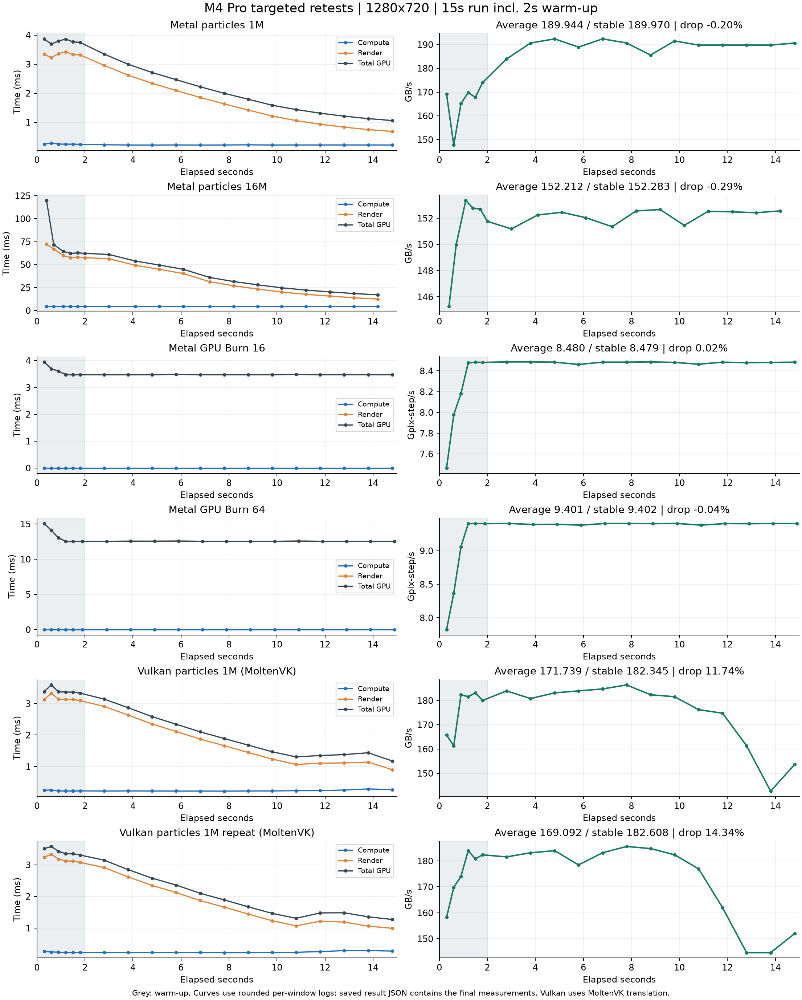

# Mac M4 Pro 待复测项目结果：2026-10-14

已完成 Mac 剩余 5 项候选的复测，并对 Vulkan 异常项按同规格冷启动补测一次，共 6 次运行。Metal 原先 7 项计时问题现已全部验证；Vulkan 1M 的吞吐变化可重复，保留待核查。手机和平板未启动测试。

使用提交 5c4e7df 的 Release arm64 应用内 worker；M4 Pro、48 GiB 统一内存、macOS 27.0.1、接通电源，关闭低电量模式。每轮系统热状态 0→0，项目间至少休息 30 秒；两轮 Vulkan 间超过 60 秒。规格保持 1280×720、运行 15 秒（2 秒预热，约 13 秒计分），关闭抓帧。

| 项目 | 均值 | 已检测稳定段 | 前后吞吐下降 | GPU 总时间 / 帧间隔（ms） | 结论 |
| --- | ---: | ---: | ---: | ---: | --- |
| Metal 粒子 1M（绘制） | 189.944 GB/s | 189.970 | -0.20% | 1.691 / 1.848 | 通过 |
| Metal 粒子 16M（绘制） | 152.212 GB/s | 152.283 | -0.29% | 27.470 / 27.675 | 通过 |
| Metal GPU Burn 16 | 8.480 Gpix-step/s | 8.479 | 0.02% | 3.478 / 3.648 | 通过 |
| Metal GPU Burn 64 | 9.401 Gpix-step/s | 9.402 | -0.04% | 12.548 / 12.743 | 通过 |
| Vulkan 粒子 1M（第一轮） | 171.739 GB/s | 182.345 | 11.74% | 1.767 / 2.194 | 吞吐变化待核查 |
| Vulkan 粒子 1M（第二轮） | 169.092 GB/s | 182.608 | 14.34% | 1.792 / 2.224 | 吞吐变化待核查 |

## 结论
本轮四项 Metal 的计算/渲染区间未重叠，GPU 总时间没有超过帧间隔，吞吐稳定段 CV 为 0.09%–0.27%。加上上轮通过的 Metal 4M 粒子、GPU Burn 256 和流体，原 7 项 Metal 计时修复现已全部完成验证。旧问题成绩继续保留；成绩口径已变更，数字增加不能当作电脑性能提升。

Vulkan 仍通过 MoltenVK 转到 Metal。粒子保留原有两帧提交配置和 gpu_timestamp_query 合同；初始化用独立计算批次与同步提交/等待核对时间戳，两轮都通过，GPU 总时间也没有超出帧间隔。第一轮均值 171.739、第二轮 169.092 GB/s，均值相差约 1.5%，但两轮后段都下降，分别为 11.74%、14.34%。这不是已经解决的稳定性问题，保留两轮记录，不继续反复测试挑最高值。

系统报告温度正常，仍不能确定下降原因；没有硬件频率遥测，不能直接认定是热降频。记录中的 stableScore 是运行中曾检测到的稳定窗口，不保证位于最后阶段；本次 Vulkan 曲线末段明显下降，182 GB/s 的稳定段不能代替整轮均值或持续性能。

## 曲线与原始结果
113 个日志窗口同时保存为 curves.csv，包含预热标记、计算/渲染/GPU 总耗时和按同一公式推导的窗口成绩。曲线采用日志输出的已舍入数字；正式均值、稳定段和前后变化以 result JSON 为准。

文件：audit.json、run-status.json、data/results/results.json；每项 *.log 为完整原生日志；mac-retest-curves.pdf 可导出。

Mac 主结果文件已从 137 条追加至 147 条：本轮 6 条，加上先前隔离验证的 4 条。全部 137 条旧数据经逐对象对比保持原样。history-update.json 记录合并、哈希和成绩编号，results-before.json / results-after.json 为完整快照。应用主文件在 /Users/fairchild/Library/Application Support/GpuComputeBenchmark/results/results.json。

原复测清单已更新：7 项 Metal 已验证，Mac Vulkan 1M 改为“复测完成、吞吐变化仍待诊断”；iPhone 7 项、iPad 4 项仍待复测。CPU、内存和已稳定的其他 Mac 项目按此前范围无需重复跑。
