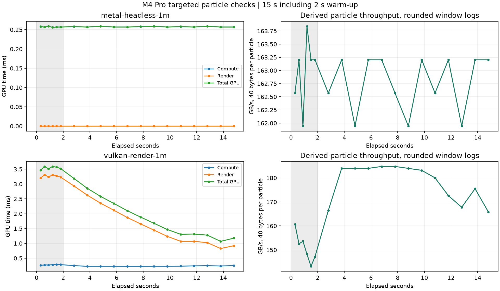
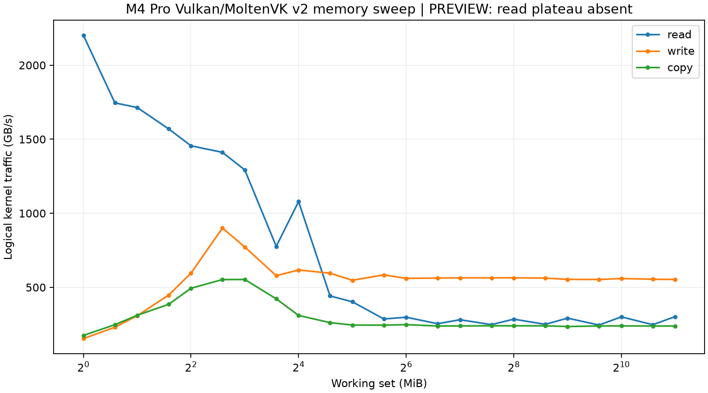

# M4 Pro 定向补测与 iOS 编译：2026-10-16

基于 `b637637`，执行 M1、M2、M4 及 M3 两项补测，共 5 次执行、6 条原始成绩。
所有进程已正常退出。未改内核、着色器、计分方式、计时实现、默认设置或质量阈值。
iOS 本轮完成真机版与模拟器版编译，没有新增手机或平板成绩。

## 条件与结果

M4 Pro / Mac16,8，14 核 CPU、48 GiB 统一内存、macOS 27.0.1。使用本次重新
编译的 Release arm64 App 内 CLI worker；CPU 调用与 App 共用同一生产实现，
本轮没有点击 GUI 按钮。接通电源、非低电量模式；当前 AC `powermode=2`，
各项目间间隔 30 秒，五次执行前后系统热状态均 0→0。
频率只在 CPU 已有统计可用处报告，没有采到 GPU 硬件频率。

| 项目 | 本轮结果 | 判断 |
| --- | ---: | --- |
| CPU 大核单线程 | 207.532 MWork/s | formal；三轮核心类型驻留校验通过 |
| CPU 小核单线程 | 69.902 MWork/s | formal；后台 QoS，三轮校验通过，不是峰值性能 |
| CPU 全核，14 线程 | 2436.328 MWork/s | formal；三轮中位数，42 个线程贡献记录完整 |
| Metal 1M 纯计算 | 162.761 GB/s | 稳定段 162.807，CV 0.34%，前后变化 -0.01% |
| Vulkan v2 内存 | 300.885 GB/s（preview） | 数据校验通过；读取平台未达到，不能作正式 DRAM 峰值 |
| Vulkan 1M 绘制 | 177.361 GB/s | 稳定段 183.293，前后下降 4.66%；历史原因仍未关闭 |

CPU 每阶段 15 秒、0.2 秒预热、三轮；粒子每项 15 秒，含 2 秒预热。
Vulkan 仍是用户允许的 MoltenVK 转译路径，窗口为 1280×720，关闭抓帧。
数学探针是单独的诊断程序，没有写入正式成绩库。

## M1：分支已保留

Xcode Apple clang 对完整 `cpu_benchmark.cpp` 以 `-O3 -DNDEBUG` 编译。
核对五处内核循环，每处均有最低位 `tbz` 分支，循环内没有 `fcsel`。
文档原来的固定 40 行扫描会扫到一个函数的循环后钳位代码，产生两条
`fcsel` 假阳性；本次按循环回边划定范围，并保留完整汇编和逐循环摘录。

三条新 CPU 记录均有 `_kept_branch`。大核选中第 2 轮，观测有效频率
4.0344 GHz，按文档公式约 19.44 周期/工作单元；最低驻留界 99.9392%。
小核三轮有效频率 1.416–1.552 GHz，最低驻留界 99.9970%；后台调度的
小核分数不能与正常性能策略相加预测全核性能。
全核三轮各自 14 个工作线程贡献之和为 2436.328454、2435.142848、
2444.409750，与最终中位数一致。线程可迁移，不把贡献编号当作物理核心。

旧 312.254 / 3581.602 等记录原样保留在旧版本组，不能混入新版比较。
本次确认了 Mac 编译分支差异的修复，不改变其他平台成绩。

## M2：数学探针

原始探针直接编译运行成功，没有修改代码。每项五次 dispatch 取最快值，
是探针自己的方法，不替代正式 Burn 的整轮均值。

| 函数 | fast，G results/s | 相对 FMA | precise，G results/s | 相对 FMA |
| --- | ---: | ---: | ---: | ---: |
| FMA | 3482.231 | 1.000 | 3527.100 | 1.000 |
| sin | 423.599 | 0.122 | 137.143 | 0.039 |
| cos | 427.974 | 0.123 | 137.873 | 0.039 |
| atan2 | 232.363 | 0.067 | 62.919 | 0.018 |
| exp | 1003.292 | 0.288 | 628.635 | 0.178 |
| pow | 486.671 | 0.140 | 34.540 | 0.010 |
| sqrt | 998.096 | 0.287 | 316.985 | 0.090 |
| division | 1002.386 | 0.288 | 182.681 | 0.052 |

FMA 折合 fast 6.964 TFLOPS、precise 7.054 TFLOPS，低于文档预估的 8–10；
没有据此修改内核或重跑挑分。该循环不是经验证的硬件峰值测法，预估不能充当
合格阈值。复制的 Burn 单步 fast 为 14.644、precise 为 4.099 Gpix-step/s；
compute 探针与正式 fragment shader 的完整工作量不同，不能替换正式 Burn 成绩。

这些结果支持 Burn 对特殊函数吞吐敏感。没有其他厂商的同实现探针，尚不能
独立量化 Apple 相对 NVIDIA/AMD 的函数速度差距，也不能据此归因全部分差。
原始输出另存于 [数学探针原档](../metal-math-probe-20261016-233740/output.txt)。

## M4：1M 纯计算计时核对

源码 headless 分支的命令缓冲只有一个 compute encoder，不执行 render/present；
使用该缓冲的 `GPUStartTime` / `GPUEndTime`，双帧排队。
新记录 compute=total GPU=0.258 ms，平均帧间隔也为 0.258 ms；
38 个粒子日志窗口中的本项 19 点平稳，没有发现 GPU 时间跨度超过帧间隔。

旧 Metal 146.696 对应 GPU 0.286 ms / 帧间隔 0.287 ms，本身也匹配。
旧 Vulkan 219.681 的 compute=0.191 ms，total GPU=0.267 ms，帧间隔=0.305 ms；
headless 日志中的其余时间不代表真实绘制。两 API 的阶段计时范围不同，不能把
219.681 / 146.696 直接归结为 Metal 慢三分之一，或断言全部差值是命令缓冲固定开销。
本次核对没有证明某个可以直接修复的计时错误，也未取得 encoder 内独立计时，
API 差异的具体原因保留未确认。没有修改计时方式。

## M3：Vulkan 内存及历史波动

默认 1–2048 MiB 扫描，3 次预热、10 次测量取中位数，共 95 个点。
使用整轮统一同步墙钟计时，`dataVerified=1`、46 次 write/copy 验证通过，
`timestampAnomalies=0`。读取大工作集呈交替波动，例如 1 GiB 300.885、
1.5 GiB 247.672、2 GiB 302.389 GB/s，`memoryPlateauReached=0`。
版本实际为 **`membw_v2_verified_preview_moltenvk`**，并非正式平台成绩。
写入摘要 554.828、复制 238.802 GB/s 也保留为本内核逻辑访问吞吐；
校验通过并不证明这些字节都经过了 DRAM，不能当作统一内存物理峰值。
`cacheAttribution=unverified`；L1 标注同样是工作组足迹推断，不是独立归属验证。

统一内存设备的 host 单独扫描按现有逻辑跳过，不是漏测。
本轮未更改默认上限、内核或计分。新版 Vulkan 内存的正式平台验收仍未完成。

Vulkan 1M 绘制总 GPU 1.715 ms / 帧间隔 2.114 ms，初始化时间戳检查通过。
本轮前后下降 4.66%，在现有 5% 阈值内；尾段仍从约 184 回落至约
166 GB/s，渲染时间随画面负载变化下降。一次低于阈值不能关闭此前 12–23%
下降的原因；系统热状态 0→0 也不能证明 GPU 频率不变。保留全部历史。

## iOS 构建与验证

测量全部结束后执行 `bash scripts/build-ios.sh`，真机与模拟器原生库、两份
Release App 均构建成功。真机 arm64，模拟器 App 和原生库实际含 arm64/x86_64。
各包的 5 个 Metal/GLES 源文件逐字节匹配当前源码，56 个 SPIR-V 资源齐全；
两平台原生库均未带 Mac 专属 `_kept_branch` 身份。

- 真机包：`build-ios/DerivedData-iphoneos/Build/Products/Release-iphoneos/Mangekyo.app`
- 模拟器包：`build-ios/DerivedData-iphonesimulator/Build/Products/Release-iphonesimulator/Mangekyo.app`
- 脚本使用 `CODE_SIGNING_ALLOWED=NO`；连接真机安装时仍需正常开发签名。
- 本轮只编译及核对资源，没有运行新的真机或模拟器全套测试。
- 原生 CTest **7/7 通过**，包含 CPU 驻留、取消、内存结果和成绩兼容性。

完整日志见 `build-macos.log`、`build-ios.log`、`ctest.log`；产物哈希与
资源校验见 `ios-build-verification.json`。原有构建警告保留在日志，未扩大修改范围。

## 保存与剩余事项

Mac 主历史由 149 追加到 **155 条**，旧 149 条逐对象不变。
主文件与 [results-after.json](results-after.json) 逐字节一致；本次 6 条单独保存于
[data/results/results.json](data/results/results.json)。`history-update.json` 保留前后哈希及编号。
`archive-index.json` 的 Mac 主入口已更新；四台 iOS 主历史哈希未变。

`audit.json`、CSV、PNG/PDF、完整汇编与每项原生日志均保存。剩余的是 Vulkan
正式内存平台和历史波动原因，以及 M4 API 差异的进一步归因；不能写成所有疑点已修好。
A16 九项、iPad8,1 的 Metal 16M 和 A15 可选项仍等待用户接回设备。
