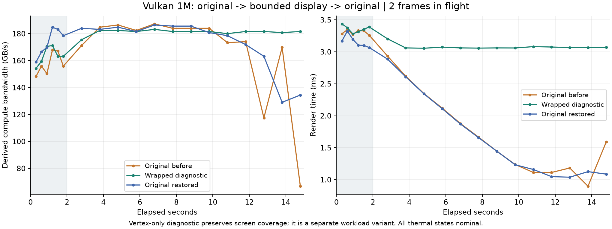

# Mac Vulkan 1M 吞吐变化诊断：2026-10-14

本轮新增 6 次实机对照。现象与动态图形负载变化有关：原绘制方式下单双帧都下降，纯计算不下降；只调整显示坐标保持画面密度后稳定，恢复原显示方式又下降。这个实验支持绘制路径/负载变化的影响，不能区分背后的 GPU 频率、驱动或调度机制。正式测试仍保留待核查标记。

## 结果

| 对照 | 均值 GB/s | 前后吞吐下降 | 已检测稳定段 GB/s | 结果 |
| --- | ---: | ---: | ---: | --- |
| 原粒子绘制，单帧 | 164.016 | 16.54% | 181.050 | 下降待核查 |
| 纯计算，双帧 | 264.140 | -1.33% | 265.584 | 稳定 |
| 纯计算，单帧 | 157.835 | 0.19% | 157.577 | 稳定 |
| 原粒子绘制，双帧（A） | 156.753 | 23.12% | 184.400 | 下降待核查 |
| 固定画面密度，双帧（B，诊断变体） | 181.467 | -0.01% | 181.120 | 稳定 |
| 恢复原粒子绘制，双帧（A） | 167.361 | 15.57% | 183.281 | 下降待核查 |

## 对照方法与判断

使用同一 Release arm64 worker、同一 1M 粒子计算、15 秒运行/2 秒预热。常规诊断仅改变是否绘制和同时提交的帧数；每轮系统热状态 0→0、接通电源、关闭低电量模式，间隔至少 60 秒。初始化计算批次的 GPU 时间戳与同步实际等待核对均通过；GPU 总时间没有超过帧间隔，也没有计算/绘制时间重叠。

粒子初始 XY 在 [-0.8,0.8]、速度在 [-0.2,0.2]，计算更新位置；原显示把 XY 直接用作画面坐标，只有越过右边界的 X 会回绕，Y 和越过左边界的 X 会移出视口。原轮次里绘制耗时随运行降低。这是持续变化的画面负载，不是完全固定的绘制负载。

B 轮在隔离的顶点着色器中把显示 XY 回绕到 [-1,1)，保持所有粒子持续出现在画面中；worker、计算和像素着色器逐文件哈希/字节验证相同。修改只存在于诊断目录，计算代码和正式应用资源没有改动。B 为不同绘制工作量的诊断变体，不能替换原标准成绩；其 raw result JSON 和 variant contract 分开保留。

A→B→A 结果：原绘制下降 23.12%，固定显示覆盖的 B 轮 -0.01%，恢复原绘制后下降 15.57%。纯计算两档也没有下降，单帧绘制仍下降 16.54%；这些结果排除了“仅靠改为单帧就能解决”的判断，并支持画面负载变化参与了现象。没有取得 GPU 频率遥测：系统 powermetrics 需要管理员权限，当前没有免交互授权；因此本轮不把变化直接称为热降频。

系统日志中的 Thermally stable/throttled 标签来自吞吐统计，不是硬件温度或频率计数。stableScore 可能取自较早的稳定窗口，不能替代有后段下降的整轮均值。纯计算日志的 Render 字段是通用四时间戳中后两个标记的间隔，不表示真实存在绘制，这里也保留原始值。

## 曲线与存档

全六轮曲线：control-curves.png / control-curves.pdf；窗口数据 curves.csv，完整核对 audit.json，原生日志 *.log。常规对照原始成绩在 data/results/results.json，B 变体在 wrapped-render-data/results/results.json。

两条与原标准配置一致的双帧绘制复测已追加到 Mac 主历史，147→149 条，旧条目逐对象验证保持原样。单帧/纯计算对照及改动显示坐标的变体在独立结果目录，不与标准配置混排。history-update.json 记录确切编号和哈希。

原复测清单已记录本轮诊断结论，7 项 Metal 验证仍通过。手机和平板未运行；没有重跑无证据要求复测的其他项目。
